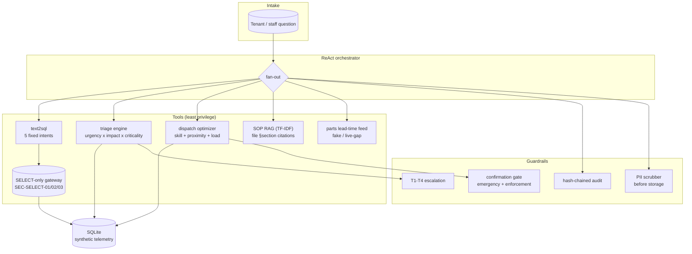

# Architecture

## Data flow
1. A question arrives at the orchestrator, which fans out to the tools
   it needs — never more.
2. Data questions go through fixed text-to-SQL templates and the
   SELECT-only gateway; the gateway cites the rule ID on every rejection.
3. Work-order questions run the triage engine (priority + cited rules),
   then the dispatch optimizer (ranked techs + breakdown).
4. SOP questions hit TF-IDF retrieval with `file §section` citations; a
   miss is surfaced as an explicit gap, never filled in.
5. Parts lead-time questions hit the fake feed in demo mode; the live
   stub raises `SignalGap`, which the orchestrator reports verbatim.
6. P1 triage escalates to T2; emergency dispatch and lease-violation
   enforcement wait on the human confirmation gate.
7. Every tool call lands in the hash-chained audit log; feedback text is
   PII-scrubbed before storage.
